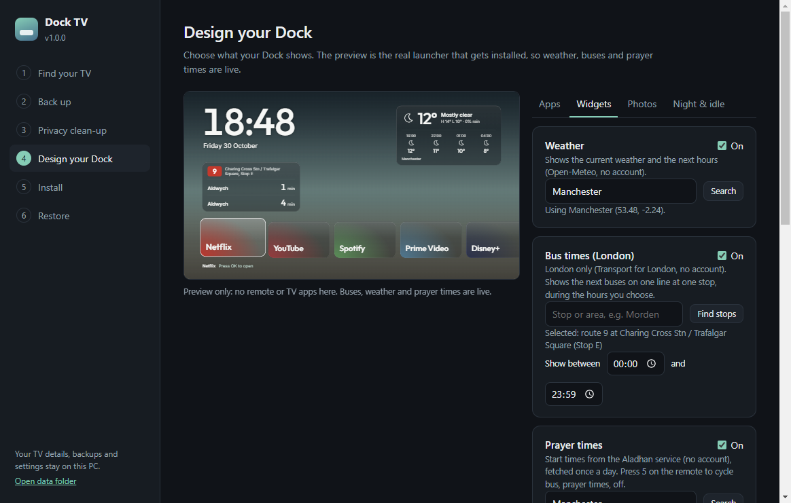

# Dock TV

Replace your Samsung TV's ad-filled home screen with a clean, customisable **Dock**, and switch off the tracking. A one-file Windows app: no scripts to run, nothing to unzip.



## What it does

- **Finds your TV** on your network and tells you honestly whether your model has been tested.
- **Backs up** what can be read from the TV before changing anything.
- **Privacy clean-up**: walks you through Samsung's tracking and ad settings. Each old value is logged first, so every change can be undone.
- **Design your Dock** with a live preview of the real launcher: apps, widgets, photos, night mode.
- **Installs** the Dock on the TV over your network. It creates the signing certificate for you on 2018-2022 TVs (no Samsung account).
- **Restore** puts every setting back and removes Dock.

### On the Dock

| | |
|---|---|
| **Apps** | Up to 8 tiles. Presets (Netflix, YouTube, Spotify, Prime Video, Disney+, Apple TV, Plex, Twitch, iPlayer, Internet), apps found on your TV, or your own. |
| **Inputs** | Connected HDMI devices appear by themselves; name or hide them. Optional Live TV tile. |
| **Clock and date** | Always there, with a colour taken from the current photo. |
| **Weather** | Current conditions and the next hours, for any town ([Open-Meteo](https://open-meteo.com), no account). |
| **Bus times** | Next buses on one London route at one stop, during hours you choose ([TfL](https://api.tfl.gov.uk), no account). |
| **Prayer times** | Start times for any town, any calculation method, Hanafi or standard Asr, with fine-tuning to match a local timetable ([Aladhan](https://aladhan.com), no account). |
| **Spotify** | What is playing, OK to play or pause, optional playlist. Needs Premium and your own free Spotify developer app. |
| **Wi-Fi** | Network name, a count of connection drops, a history and a speed test. |
| **Night mode** | A dark veil on a schedule, and optional night photos. |
| **Photos** | Free Wikimedia Commons photos by theme, or your own pictures (resized for you). The photographer is credited on screen. |

Press `5` on the remote to cycle the bus and prayer cards; OK on a card opens its detail.

## Compatibility

| TV | Status |
|---|---|
| Samsung UE55NU7021 (2018, Tizen 4.0) | Tested end to end by the author |
| Other 2018 models | Expected to work, **not tested** |
| 2019 and newer, older than 2018 | **Not tested.** The Dock is plain old-browser HTML so it should run, but the Developer Mode steps and privacy menu names differ, and newer TVs may refuse the free certificate and need a Samsung one |

Dock TV reads your model and shows this status in the app. If you try it on another model, please open an issue with the model number and what happened.

**What is and is not verified in this release.** Run on the real UE55NU7021: the launcher with weather, buses, prayer times, Spotify, inputs and night mode (it is the author's daily Dock); signing with the auto-created `DockTizen` certificate; installing and launching over the network. Verified without a TV, by tests or live lookups: the settings model and generated config, place and bus-stop search, Spotify link parsing and PKCE, photo downloads, SDK and certificate detection, and a full dry-run of build, sign and package. **Not yet run on a real TV:** the Spotify login flow inside this app, the Electron version of the final install click, and Restore's uninstall step. Other TV models are untested.

## Get started

1. Download `DockTV-x.y.z-portable.exe` from [Releases](../../releases) and run it. Windows SmartScreen may warn about an unrecognised publisher because the app is not code-signed. Choose *More info > Run anyway* if you trust it, or build it yourself (below).
2. Follow the six steps in the sidebar.

### One-off setup Samsung requires for any custom TV app

- **Tizen SDK.** Install Visual Studio Code, add the *Tizen TV* extension (publisher `samsungtvsdk`), and let it install the Tizen SDK. Dock TV finds it by itself, or you can point it at the folder.
- **Developer Mode on the TV.** Home > APPS, press `1 2 3 4 5`, turn Developer mode On, enter your PC's IP, then restart the TV by holding power for 5+ seconds. The Install step shows exactly what to do. The TV's info page can keep showing an old IP after you change it; if the connection works, the install works.
- **A certificate.** On 2018-2022 TVs Dock TV creates a free Tizen developer certificate (`DockTizen`) for you. Newer TVs may need a Samsung certificate made in VS Code with the TV's DUID ticked; if you have several profiles, Dock TV tries each until the TV accepts one.

Turn Developer Mode off again afterwards.

## Safety and privacy

- Nothing is uninstalled from the TV. The only app Dock TV installs is Dock.
- Privacy settings are changed by you, with the remote. Dock TV logs the old value first. Leave Samsung's *Smart Hub Terms* and *Privacy Notice* agreed or Netflix, YouTube and Spotify stop working.
- The DNS step points the TV at AdGuard DNS (`94.140.14.14`) to block ad and tracking domains. It does not remove ads inside YouTube videos.
- Your TV's details, backups, settings and Spotify login are stored in your Windows user profile (`%APPDATA%\Dock TV\data`), never in the app folder or the repo. The Spotify token (no client secret exists) is added only to the temporary build copy that goes to your TV and is deleted afterwards. Use *Open data folder* in the sidebar.
- The app talks to your TV on your local network, plus Wikimedia (photos), Open-Meteo (weather), TfL (buses), Aladhan (prayer times) and Spotify if you use those features. No analytics, no accounts of its own.
- Use at your own risk. This is an unofficial tool, not affiliated with Samsung. Changing TV settings or enabling Developer Mode could affect your warranty or support; check Samsung's terms.

## Build from source

```bash
npm install
npm test          # runs against a fake TV and a fake SDK folder
npm start         # run the app
npm run dist      # portable .exe in release/
```

Build from a short folder path (for example `C:\dev\dock-tv`): the installer tooling fails when the path is over Windows' 260-character limit.

```
main.js, preload.js   Electron main process and the small API the UI may call
lib/                  TV discovery, Tizen SDK + certificates, settings model, places, Spotify, wallpapers, change log
launcher/             The Dock that runs on the TV (ES5, for the old Tizen 4 browser)
ui/                   The app window
test/run.js           Tests (no TV needed)
```

The live preview is the same `launcher/` code that goes to the TV, with the settings you chose written to `js/dock-config.js`.

## Credits

- Inter and Outfit typefaces, SIL Open Font Licence (`launcher/fonts`).
- Photos: Wikimedia Commons Featured Pictures. Each photographer and licence is shown on screen and saved to `SOURCES.txt`.
- Weather: [Open-Meteo](https://open-meteo.com) (CC BY 4.0). Buses: Transport for London open data. Prayer times: [Aladhan](https://aladhan.com).
- Samsung, Tizen, Netflix, YouTube and Spotify are trademarks of their owners.

## Licence

MIT. See `LICENSE`.
